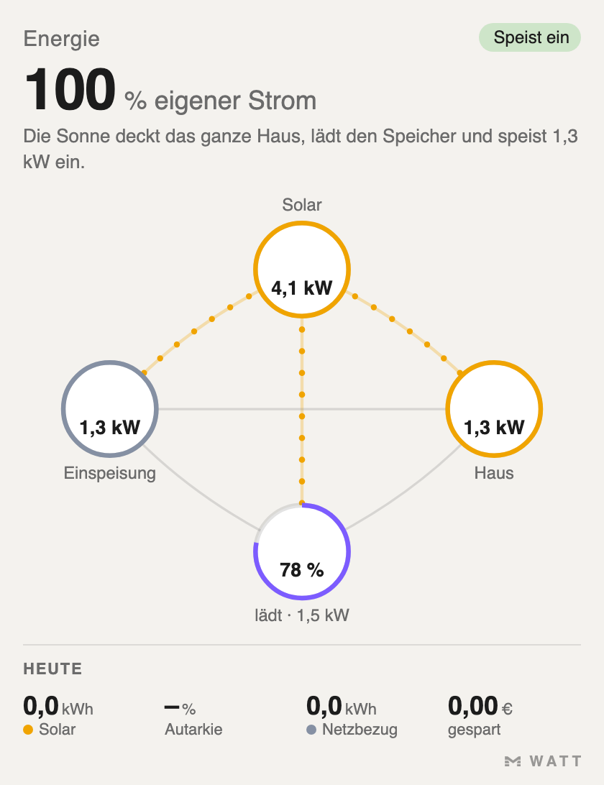
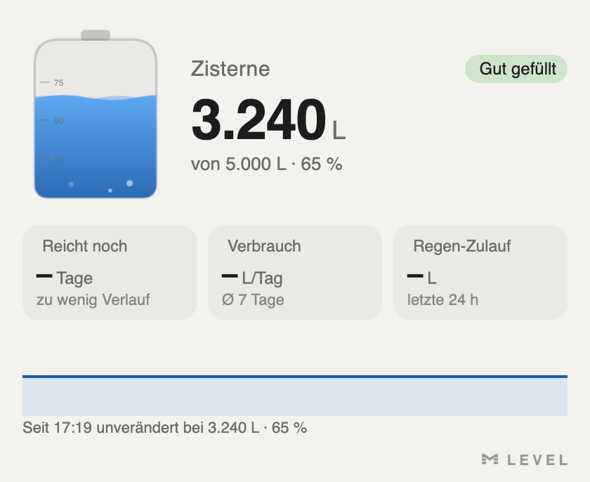
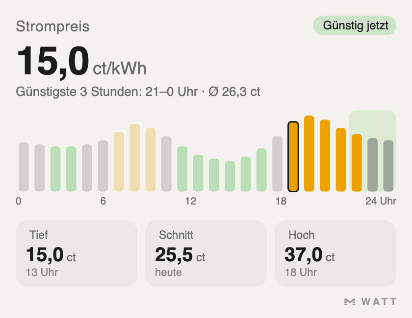
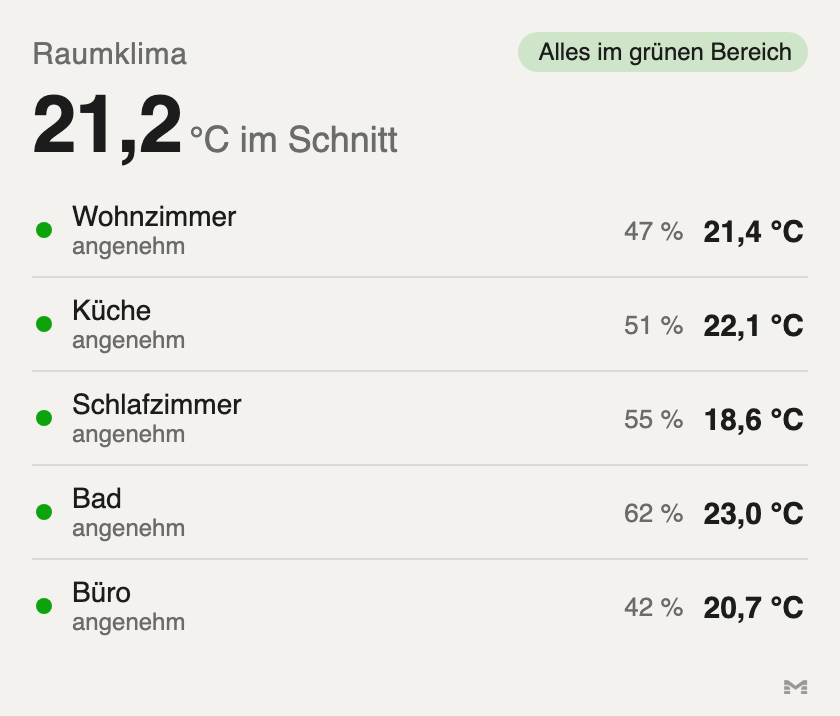
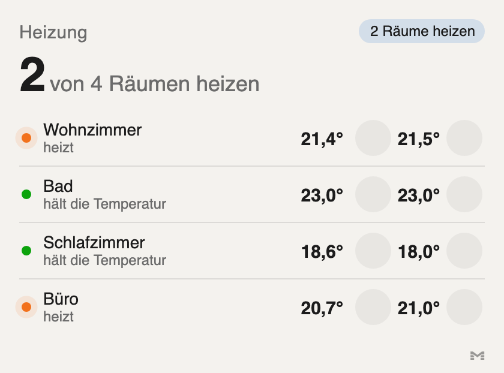
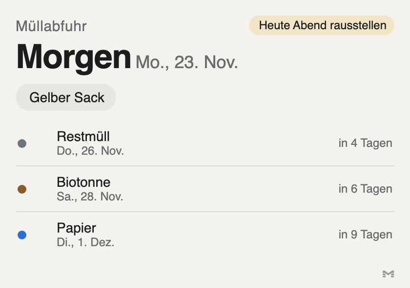

# MANGFALL Apps — Home Assistant add-on repository and HACS source for the MANGFALL cards

Status: product · Owner: Software · Language of this repo: English (customer sections in German)

The only public MANGFALL repository. It ships the **MANGFALL Karten**: 26 Lovelace cards that find their
sensors on their own, in one calm design. Two ways in, same file:

- as a Home Assistant add-on (`mangfall-cards/`), which copies the cards into `/config/www/mangfall/` and registers
  the dashboard resource itself — no HACS needed; preinstalled on HAGLO servers by the provisioning stick;
- as a HACS frontend repository (`hacs.json`; the release asset `mangfall-cards.js`).

Haglo Assist (haglotech/addons) uses the same cards and builds dashboards with them.

## Für Kunden

**MANGFALL Karten** – schöne Dashboard-Karten für Home Assistant, die ihre Sensoren selbst finden.
Zisterne, Energiefluss, Strompreis, Raumklima, Heizung, Batterien, Fenster und Türen, Mähroboter,
Müllabfuhr, Wetter und mehr. Kein YAML, kein roter Fehlerkasten, alles auf Deutsch.

<p>
  
  
  
</p>
<p>
  
  
  
</p>

[](https://my.home-assistant.io/redirect/supervisor_add_addon_repository/?repository_url=https%3A%2F%2Fgithub.com%2Fmangfall%2Faddons)
[](https://my.home-assistant.io/redirect/hacs_repository/?owner=mangfall&repository=addons&category=plugin)

### Installation als App (empfohlen)

1. Oben auf **„Repository hinzufügen“** klicken – oder von Hand: **Einstellungen → Apps** (früher „Add-ons“) **→ App Store → ⋮ → Repositories**
   und `https://github.com/mangfall/addons` eintragen.
2. **MANGFALL Karten** installieren und starten. Die App richtet die Karten ein und beendet sich danach.
3. Im Dashboard: **Bearbeiten → Karte hinzufügen →** nach „MANGFALL“ suchen.

### Installation über HACS

HACS → **⋮ → Benutzerdefinierte Repositories** → `https://github.com/mangfall/addons`, Typ **Dashboard** →
„MANGFALL Karten“ herunterladen.

Die Karten senden keine Daten nach außen. Mehr unter [mangfall.eu/karten](https://mangfall.eu/karten).

## Layout

| Path | Content |
|---|---|
| `mangfall-cards/app/mangfall-cards.js` | The card library (single source of truth, `MC_VERSION`) |
| `mangfall-cards/app/run.py` | Add-on: copy the file, register/update the resource, take over Haglo Assist's copy, skip HACS copies |
| `mangfall-cards/tests/` | `cards.test.mjs` (render tests with an anonymised sample home), `test_run.py` (resource planning) |
| `tools/` | `demo_home.py` builds an invented sample home, `shots.mjs` renders card screenshots with Playwright |
| `repository.yaml`, `hacs.json` | Required at the top level by the Home Assistant add-on store and by HACS |

## Test

```sh
node mangfall-cards/tests/cards.test.mjs
python3 -m unittest discover -s mangfall-cards/tests -p 'test_*.py'
```

Never put real Home Assistant data into this public repository; fixtures stay anonymised.

## Release

1. Bump `MC_VERSION` in `mangfall-cards.js` and `version` in `mangfall-cards/config.yaml` (same number),
   add a line to `mangfall-cards/CHANGELOG.md`.
2. Tag `vX.Y.Z` on `main` (CEO go first). The release workflow attaches `mangfall-cards.js` for HACS.
3. Copy the new file into Haglo Assist (`haglotech/addons/haglo-assist/app/cards/`) so both stay equal.

## Licence

Code: MIT (see `LICENSE`). The name MANGFALL and the logo are not covered (see `NOTICE`).
